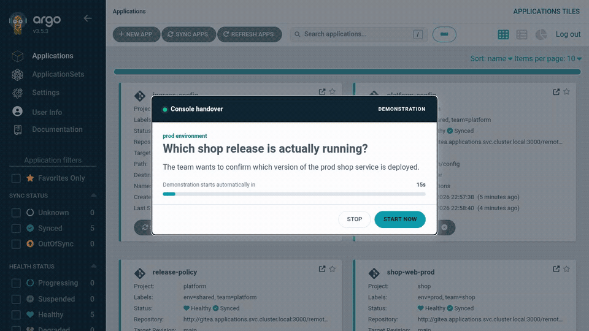

# Argo RemoteLab



This recording predates the new curriculum order. The first mission now goes straight from the Application to History; the next mission covers health.

Argo RemoteLab teaches a new operator to find deployment evidence in the Argo CD console and use that evidence to repair a GitOps release. The [UI plan](WRAPPING_UI_PLAN.md) describes the curriculum and architecture; [Phase 0 findings](docs/WRAPPING_UI_PHASE0.md) record what has been verified against pinned components and what still needs a running lab. The [ELK-Guide history review](docs/ELK_GUIDE_HISTORY_LESSONS.md) records the lessons applied to this coach.

## First time here?

Argo RemoteLab is a Kubernetes lab that runs locally on your Mac. **Colima** provides a small Linux virtual machine, and **k3s** runs the Kubernetes cluster inside it. Kubernetes uses **containerd** to run containers. The deployment script prepares this cluster and installs the lab's components from this repository; Colima is the local host for the lab, not the lab application itself.

On macOS, you don't need to create the cluster manually: `bash scripts/deploy-all.sh` creates or starts the dedicated Colima profile and deploys the lab into it. The [local setup section](#run-locally) lists prerequisites, explains first-run setup, and shows where to open the lab afterward.

## Learning modes

| Mode | What happens | Completion |
| --- | --- | --- |
| Demonstration | The coach navigates and explains the evidence, applying a reference fix in repair missions. | Unscored debrief. |
| Guided | The learner finds the target in Argo and answers short evidence checks, with optional hints. Repair missions also require a fix. | Evidence checks for Level 1; healthy deployment and incident note for repair missions. |
| Challenge | The learner gets an incident brief and can investigate freely. | Healthy deployment and incident note; remediation, console evidence, diagnosis, and operating habits are scored. |

The launcher defaults to **Demonstration** and recommends **Console orientation** until it is completed. A preparation screen stays open while the lab sets up the mission, then opens Argo CD and its briefing automatically when the scenario is ready. A 15-second progress bar counts down before the coach enters the demonstration. **Start now** skips the countdown. Every subsequent automatic step waits at least 15 seconds, with a visible countdown, so there is time to read each explanation and result. **Pause** freezes the countdown, including during the briefing; **Resume** continues it, even after an Argo page reload. The countdown also pauses while the tab is hidden. An Argo click already in progress can finish before the pause takes effect. **Advance** completes the current countdown immediately and continues the demonstration. The coach points to Argo controls, opens the evidence, advances the checks, applies the reference fix when needed, and shows the debrief automatically. Four short Level 1 missions cover finding a deployed revision, checking the version of an unhealthy service, reading a resource manifest, and reading release history. The other scenarios progress from a missing ConfigMap and failed probe through sync operations, SOPS rendering failures, and multi-environment incidents. One run owns the shared cluster at a time. Starting another mission, including from a fresh tab after closing Argo, stops the previous run and waits for its worker before resetting the Git repository to the `baseline` tag and restoring the shop Applications.

In **Shop pods are failing to start**, Demonstration opens the Deployment template in Gitea at the failing revision, points out the missing ConfigMap reference, commits and pushes the reference repair, then shows the actual commit and diff in Gitea before returning to Argo CD History. Other Git repair demonstrations also show their resulting commit in Gitea. The coach advances through these views automatically; Pause and Advance work on the Git pages too.

Each mission opens with a short statement of the problem. Demonstration explains the next evidence view, why that view helps, and what the observed result means before moving to the next step. Guided practice keeps the reason visible while the learner investigates, then pauses on the finding before continuing. The scenario-specific narrative lives in `learning/incident-framing.json`; the scenario packs continue to define the facts, answers, and evidence targets.

The console contains `shop-web-prod`, `shop-web-staging`, and three healthy platform Applications. The coach watches the browser's Argo URL and API actions, while the controller checks the actual Application status, endpoint, Git revision, and scenario-specific outcome. Opening a tab alone does not complete a Guided evidence check.

## Run locally

On macOS, use an isolated Colima k3s cluster. The deployment script creates or reuses the `argo-remotelab` profile with 4 CPUs and 8 GiB of memory. New profiles use Apple's `vz` virtualization on macOS 13 or later; older macOS versions require QEMU (`brew install qemu`). It uses a temporary kubeconfig scoped to that profile, leaving your active `kubectl` context alone. Set `COLIMA_PROFILE` to use another dedicated profile; use the same value for cleanup. On Linux, the script starts the host k3s service if it is stopped and allows up to 15 seconds for its API to respond before deploying. If the local kubeconfig credentials are rejected, it stops and points to `./scripts/manual-refresh.sh`, which verifies the current k3s credentials and backs up the local kubeconfig before replacing it. Full Linux deployment prompts for sudo before changing lab resources and again if needed before importing Docker images into k3s. If k3s advertises an IP different from the host's current IP, it updates k3s's advertised IPs and allows 15 seconds for the API, node, and Kubernetes endpoint to recover after restarting k3s.

Prerequisites: Colima with k3s and containerd on macOS, or an installed k3s systemd service on Linux; plus `kubectl`, `helm`, `age-keygen`, `sops`, `jq`, and Docker or `nerdctl` for local image builds. Local development pins Node 24.21.0 in `.nvmrc` and Python 3.14.8 in `.python-version`; deployment images carry their own runtime pins. The script checks the required tools during setup.

On Apple Silicon, install OpenSSH with Apple Silicon Homebrew so Colima can find a native `ssh-keygen` when creating its first VM:

```bash
brew install openssh
command -v ssh-keygen
```

The resolved command should be under `/opt/homebrew/bin`. If it resolves to an Intel Homebrew binary under `/usr/local/bin`, put `/opt/homebrew/bin` before `/usr/local/bin` in `PATH` or invoke deployment with `PATH="/opt/homebrew/bin:$PATH"`. Colima needs `ssh-keygen` during its initial VM startup; a wrong-architecture binary can fail with `bad CPU type in executable`.

```bash
bash scripts/deploy-all.sh
# Later, to remove only this lab's resources:
bash scripts/cleanup-all.sh
```

Run `bash scripts/deploy-all.sh` for both initial setup and later reruns; it
checks warm deployment readiness automatically. When the existing lab is ready
and its infrastructure dependency pins match this checkout, it selects a warm
deployment. If lab resources are missing or infrastructure pins changed, it
runs the full setup and recreates the lab namespaces. An existing deployment
that is temporarily unready stops the run before cleanup. Use `--full` to
recreate lab resources explicitly; unchanged local images are reused.
PostgreSQL 16 volumes need a data migration before PostgreSQL 18 can reuse
them; `--skip-cleanup` stops if it finds an older PostgreSQL deployment,
and the database pod checks the volume version before startup. Use `--full`
for a disposable lab.

On macOS, deployment checks registry access from inside the Colima VM and
retries brief failures. If only the lab profile has a persistent failure, it
restarts that profile and waits for Kubernetes. If the lab and default profiles
both lose access while the Mac can reach the registry, it stops and starts
both profiles to refresh their shared Lima network. It restores default-profile
containers that were running with Docker's `restart=no` or `on-failure` policy.
The script checks access again before restarting and prints the failed probe
if recovery does not work. If the Mac itself cannot reach the registry, it
reports the host failure without disrupting Colima. Other running profiles
are left alone.

Warm deployment resets the current mission while keeping the Colima profile, Argo CD, PostgreSQL, Gitea, persistent volumes, and SOPS key. It restores the Git baseline, waits for the Applications to become Healthy and Synced, and rebuilds first-party images whose source or image tag changed, including the sample Django app. If the local app, chart, or platform source changed, it seeds a new baseline and release history.

Full deployment prepares first-party images before deleting lab namespaces. It reuses images whose recorded source hash and tag match and that are still present locally, then builds remaining images two at a time. A build failure stops before cleanup. On Linux, `nerdctl` builds directly into k3s's containerd when installed; the Docker fallback imports images only when a rebuild is needed. Warm readiness hashes the pinned infrastructure manifests and `scripts/lib/infrastructure-settings.sh`, so edits to image build orchestration and first-party image tags do not force a full deployment. Use `--full` when changing full-only cluster setup logic outside those inputs.

The deployment script starts local port-forwards for the lab gateway at `https://localhost:8443/` and Gitea at `http://localhost:3000/`. Open the lab at `https://localhost:8443/` and Gitea's browser UI at `https://localhost:8443/gitea/`, accepting the local certificate. The direct Gitea port-forward at `http://localhost:3000/` is for deployment scripts and API access; because Gitea is configured under the `/gitea/` path, opening its UI directly there will leave its static assets unstyled. The port-forwards keep running after deployment and are stopped by `cleanup-all.sh`.

Choose a scenario, assistance mode, environment, and optional scenario key. Each run creates fresh Git revisions for both shop Applications; the key controls scenario variants, while the revision identifies that particular run. The preparation screen waits for the controller's scenario readiness check and keeps the Argo CD interface out of view until then. It signs in as the scoped `learner` account and opens the briefing automatically. If preparation fails or another run replaces it, the screen shows the reason and links back to the launcher. Direct Argo CD access at `https://localhost:8443/argocd/` still accepts `admin / remotelab` for manual exploration. If you chose another `COLIMA_PROFILE`, replace `colima-argo-remotelab` with `colima-<your-profile>` in the `kubectl` examples below.

The docked terminal is at `/terminal/`. Minimize it from its header to keep the shell open, and drag the upper-left corner to resize it. Gitea remains the Git host and webhook source, and its repository is viewable at `/gitea/`; the Guided repair does not require its browser editor. Gitea's lab credentials are `remotelab / remotelab`. The generated age key is saved at `secrets/keys/local.key` and mounted in the lab terminal. Gitea pushes notify both Argo CD and the learning service.

```bash
# Read the two shop Applications and the controller's current run activity.
kubectl --context colima-argo-remotelab -n argocd get applications shop-web-prod shop-web-staging
kubectl --context colima-argo-remotelab -n applications logs deployment/scenario-controller --tail=80
```

For a Git fix, edit the affected chart in the lab terminal, commit, and push. The chart paths are `chart/django-app/` for production and `chart/django-app-staging/` for staging. The terminal has `git`, `kubectl`, `sops`, `age`, `jq`, and `yq`. When editing encrypted values, keep `secrets.yaml.enc` encrypted in Git and pass explicit YAML types to SOPS:

```bash
sops --decrypt --input-type yaml --output-type yaml chart/django-app/secrets.yaml.enc
```

After a repair, verify **Healthy** and **Synced** in the Application header, then open **History and Rollback** to read the deployed revision. The incident note closes the run. The debrief lists the steps taken and what each revealed. Guided and Challenge debriefs also show operating notes; Guided reports assistance used, while Challenge can expand the score breakdown and reference finding. Replay options return to the launcher.

The controller also retains its older autonomous scenario loop when started without `LAB_MODE=api`; the launcher deployment sets `LAB_MODE=api` to coordinate one reproducible run at a time.

## Components

| Path | Role |
| --- | --- |
| `argocd-apps/`, `sample-django-app/` | Staging and production Applications, projects, platform apps, and Helm chart source. |
| `scenario-controller/` | Go run API, baseline reset, injectors, readiness and outcome probes. |
| `learning/`, `learning-service/` | Scenario packs, evidence targets, sessions, checks, scoring, notes, webhook intake. |
| `argocd-coach/` | Same-origin bootstrap, Argo action observer, Guided clock, Shadow DOM coach. |
| `lab-gateway/`, `lab-launcher/`, `lab-terminal/` | Nginx gateway, curriculum entry page, browser terminal. |
| `scripts/`, `playground/iximiuz/` | Local and preloaded VM deployment paths. |

The iximiuz image exposes the launcher through the `argocd` tab on port `30080`. Its bootstrap uses `scripts/deploy-preloaded-vm.sh`; `scripts/build-rootfs-image.sh` packages the first-party images and manifests for that path.

The VM bootstrap logs UTC start times and durations for image import, manifest
applies, rollouts, repository setup, history seeding, and gateway readiness.
Read them with `journalctl -u gitops-lab-bootstrap.service -b -o cat` when
comparing cold starts. After a successful deployment, it writes
`/var/lib/argo-remotelab/provisioned-version`. A reboot with the matching
version waits for the existing workloads and keeps learner state. If recovery
fails, the service reports the failure and retries without deleting namespaces.
Bump `provision_version` in the bootstrap script when an image or deployment
schema change requires a fresh lab build.

## Publish an iximiuz rootfs image

After signing in to GHCR with Docker, run one command with a new version tag:

```bash
bash scripts/publish-rootfs-image.sh v9
```

The command rebuilds and pushes all six first-party images and the rootfs image
under that tag. After the rootfs push succeeds, it updates the application image
references, `scripts/lib/versions.sh`, and
`playground/iximiuz/manifest.yaml` to use the new tag, then updates the remote
iximiuz playground with `labctl playground update`. Install `labctl` first;
the command checks `labctl auth whoami` and runs `labctl auth login` if needed
before building. If the remote update fails after the push, retry it without
rebuilding with `bash scripts/publish-rootfs-image.sh --sync-remote`. Use a
fresh tag for each release so new playground sessions pull the new image.

The rootfs preloads ten Kubernetes images: the six lab images, PostgreSQL,
Gitea, Argo CD, and Redis. The PostgreSQL and Gitea init containers reuse their
application images, and the optional Django verification Job reuses the Django
image. The iximiuz repo-server uses the prebuilt Argo tools image. The separate
Alpine image in `manifests/gitops/argocd-sops-config.yaml` serves only the local
full deployment and is not included in the iximiuz rootfs archive.

Gitea is pulled from its publisher's GHCR package. PostgreSQL and the Docker
Official Image bases use Docker's verified public ECR repositories; Redis uses
its maintainers' GHCR image, and Argo CD continues to use Quay. The iximiuz
base, lab images, and published rootfs use GHCR. The rootfs and Argo tools
Dockerfiles use BuildKit's default frontend, so building them does not fetch
`docker/dockerfile` from Docker Hub.

## Checks

```bash
cd scenario-controller && go test ./...
cd ..
python3 -m unittest discover -s learning-service -p 'test*.py' -v
python3 -m unittest discover -s tests -p 'test*.py' -v
node --test argocd-coach/test/*.test.mjs
bash -n scripts/*.sh lab-terminal/*.sh
# With the dedicated local lab running:
python3 tests/live_reset_soak.py --context colima-argo-remotelab
python3 tests/live_mode_matrix.py --context colima-argo-remotelab
python3 tests/live_terminal_fix.py --context colima-argo-remotelab
cd scenario-recorder && npm ci && KUBE_CONTEXT=colima-argo-remotelab npm run record
KUBE_CONTEXT=colima-argo-remotelab npm run guided
KUBE_CONTEXT=colima-argo-remotelab npm run demo
DEMO_ONLY_SCENARIO=missing-configmap KUBE_CONTEXT=colima-argo-remotelab npm run demo
```

The live scripts reset the shared lab and must run one at a time. `scenario-recorder` checks the real Argo 3.5.3 list and History UI, Guided orientation, light and dark theme following, and versioned coach-panel image baselines. Its `guided` run follows a failure from Argo evidence through a docked-terminal Git push and back to History and debrief. Its `demo` run checks the default mode, replacement of a closed-tab run, the visible cursor and click cue, and automatic orientation completion; `DEMO_ONLY_SCENARIO` checks a full reference repair, including the Gitea source and commit views for `missing-configmap`. After the full Argo CD 3.5.3 upgrade, review the captured panels and run with `UPDATE_BASELINES=1` to create its new visual baselines. The mode matrix uses the controller's reference fix as a fixture for Guided and Challenge; the separate terminal test exercises a learner Git push. See the verification findings for current live results and remaining gates.

To verify every current mission through the browser in Demonstration mode, start a gateway port-forward in one terminal:

```bash
kubectl --context colima-argo-remotelab -n applications port-forward svc/lab-gateway 18080:8080
```

Then use the Playwright CLI in another terminal:

```bash
cd scenario-recorder
npm ci
./node_modules/.bin/playwright cli -s=demo-matrix open --browser chromium http://127.0.0.1:18080/
./node_modules/.bin/playwright cli -s=demo-matrix run-code --filename demo-matrix.cli.js
./node_modules/.bin/playwright cli -s=demo-matrix close
```

The CLI script reads the live catalog, advances each demonstration, and requires a debrief and a `COMPLETED` controller run for every mission. To run one level, mission, or environment, open `http://127.0.0.1:18080/?level=3`, `http://127.0.0.1:18080/?scenario=stale-job`, or `http://127.0.0.1:18080/?environment=staging` before the `run-code` command. Add `&autoplay=1` to let the demonstration complete without any test clicks. The `missing-configmap` check requires visits to both Git pages and the same commit in Argo's deployed revision. The script resets the shared lab between missions.

To refresh the opening GIF after the lab is ready, install `ffmpeg`, then run `cd scenario-recorder && npm ci && npx playwright install chromium && KUBE_CONTEXT=colima-argo-remotelab npm run readme-demo` (use `KUBE_CONTEXT=default` for a Linux k3s lab). Set `CHROME_EXECUTABLE` to a local Chrome binary instead of installing Playwright Chromium if preferred. The recorder runs **Console orientation** in Demonstration mode, saves the original video and timing in ignored `scenario-recorder/artifacts/`, and writes `docs/assets/console-orientation.gif`. It replaces the current lab run, so run it when no learner is using the shared cluster.
